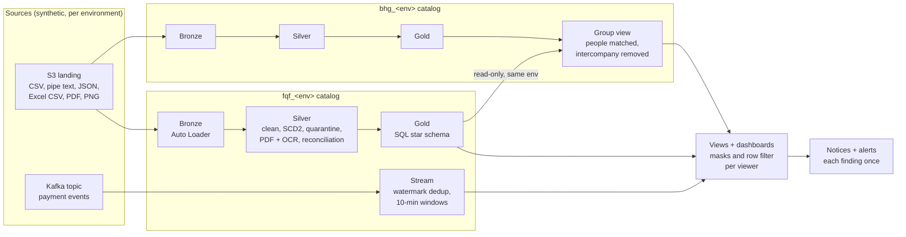

# flexi_quant_finance_fd: Flexi Quant Finance lakehouse
Databricks lakehouse of Flexi Quant Finance (FQF, the acquired lender), built to the parent's standard; its prod Gold
feeds the group view in `bio_health_group_hd`. Includes the real-time payment stream.

## The problem
A healthcare group (BHG) acquired a lender (FQF). The parent had standard pipelines; the child's data was spread over
8 sources in 6 formats, messy and duplicated. The task: build the child's pipelines to the parent's standard, keep
every company and environment isolated, protect personal data, and give the parent one trustworthy group view every
night, with only code (never data) moving between environments.

## Architecture

Two repos share one framework (over 100 files kept identical by a CI guard). Each company has `dev`, `test` and `prod`
catalogs with `bronze`, `silver`, `gold` and `ops`; BHG prod reads FQF prod Gold read-only for the group view.

## What it proves
| Area | Proof (prod unless stated) |
|---|---|
| Messy sources | 24 tables in 6 formats incl. a PDF bank statement and OCR of deposit-slip images; quarantine, orphans, late rows, a new column backfilled |
| History and modelling | SCD2 in Silver; Gold in SQL (one file per table), point-in-time joins, every invoice and loan reconciles |
| Group view | 401 people matched across companies of 1,180; 352 of 381 hospital-bill payouts matched; intercompany money counted once |
| Real time | Kafka -> Structured Streaming -> 10-minute windows -> failed-payment velocity alert, mailed once |
| Release safety | PRs with approval, 10 checks + tests + CodeQL, hotfix path with back-merge proven in prod, Asset Bundle validated in CI |
| Operations | jobs as code on a night schedule, simulator chain, alerts and weekly digest, runbook and disaster-recovery note |
| Performance | prod daily runs 11-14 min -> 7-10 min after measured tuning |

## Security and privacy
- Column masks, keyed tokens (key readable only by the job account, not even by admins), a row filter and closed raw
  files; readers query dashboards as themselves.
- Least privilege: jobs run as service principals; CI deploys as an account with no data access.
- No secret, key, id or address in Git: GitHub secrets and Databricks secret scopes only; actions pinned by commit hash,
  secret scanning with push protection, Dependabot, CodeQL. All data is synthetic.

## Read more
`docs/runbook.md` (operations), `docs/disaster_recovery.md`, `docs/performance.md`, `docs/adr/` (11 decisions),
`CHANGELOG.md`. Each section below covers one part of the build.

## Layout
| Folder | What it holds |
|---|---|
| `simulator/` | synthetic source data generator (a GitHub Action writes the files to the S3 landing folder) |
| `bronze/`, `silver/` | load raw files with Auto Loader, then clean, standardise and keep history (`src/lh/bronze.py`, `silver.py`) |
| `gold/` | Gold runners. The Gold logic itself is SQL, one SELECT per table: `gold/sql/<table>.sql` |
| `security/` | column masks and row filters, driven by `config/privacy.yml` |
| `bi/` | BI views and AI/BI dashboards (published per environment) |
| `jobs/` | the daily job as code (`config/jobs.yml`) |
| `checks/` | automated checks (t00 = smoke check of every daily run, t28 = deployed jobs match config, t29 = each person's own access matches the access matrix, t33 = data dictionary in the catalog) |
| `stream/` | 5.14 real-time payment events: Kafka producer and the stream runner (FQF) |
| `docs/` | operations runbook, disaster recovery, performance and cost, decision records (`adr/`) |
| `ci/`, `.github/workflows/` | promotion checks, approval notices, deploy after a merge, business notices, alerts and the weekly digest |
| `config/` | every setting, per environment. No secrets: they live in GitHub secrets and Databricks secret scopes |
| `setup_once/` | one-time environment setup and access grants (admin); access matrix in `src/lh/access.py`, checked by `02_verify_setup` |

## One framework, every table on its own (requirement 17)
Bronze and Silver are metadata-driven: one engine per layer (`src/lh/bronze.py`, `src/lh/silver.py`) and one
config entry per table (`config/tables.yml`, `config/silver.yml`). Gold is one SQL file per table. Every table
still has its own load: its own Auto Loader checkpoint and files, Silver watermark, quarantine rows, audit row
(`bronze.<table>`) and checkpoint result. To work on a single table, open `bronze/01_load_bronze` or
`silver/01_load_silver` in your dev Git folder, set `env = dev` and `table = <name>` and run it; the default
`table = all` is what the daily job runs. A new table = one config entry (+ its check), no new notebook.

## How code moves
- Work happens on `fqf_dev`: each person runs their own dev job (`lh_fqf_dev_daily_<role>`).
- `fqf_dev` -> `fqf_test` and `fqf_test` -> `fqf_prod` only by pull request. Checks run first; the Manager
  approves test, the Business-user Manager approves prod. A rejection sends the change back to the lower branch.
- After a merge, CI pulls the environment's Git folder, redeploys the daily job and checks it (`checks/t28_jobs`).
- Only code moves between environments, never data. No personal data, address or secret is ever committed.

## Emergency hotfix (10j)
For a prod problem that cannot wait for the normal path (rules in `config/ci.yml`, checked by `ci/route.py`):
1. Branch `fqf_hotfix_<name>` from `fqf_prod`, make the fix, push.
2. Pull request into `fqf_test`: same checks, URGENT approval by Management (environment `fqf_test_hotfix`).
   Merge with "Create a merge commit".
3. Pull request into `fqf_prod`: accepted only once the fix is in test and the branch holds only prod + the fix;
   the Business-user Manager approves.
4. After the prod deploy, `backmerge.yml` (`ci/backmerge.py`) opens a pull request `fqf_prod -> fqf_dev`
   so dev keeps the fix. Merge it with "Create a merge commit", then delete the hotfix branch.

## Controlled refresh (5.11)
Test and dev can get a safe copy of real-looking data: prod -> test (half of the people), test -> dev (a tenth).
Rules in `config/refresh.yml`, logic in `src/lh/refresh.py`. People are picked by a keyed hash of their national id
(the same people in BHG and FQF) with all their rows; reference rows come complete. Personal values are faked, the ids
of `config/privacy.yml` are re-keyed with a secret key, amounts are kept. The source job account writes only sanitised
files into the target's `ops.refresh_in`; the target adds them to its Silver (its own rows stay) and rebuilds Gold.
1. Actions -> **refresh** -> Run workflow, "Use workflow from" = the prod branch, target = test. Approve the
   `<code>_refresh` environment. Do FQF first, then BHG.
2. The workflow runs `refresh/01_refresh_out` (source), `refresh/02_refresh_in` and the normal test job (target).
3. Check: `checks/t31_refresh` with env = test.
For dev: same with target = dev; then each person runs `refresh/02_refresh_in` (env dev) and their own dev job.
A Silver rebuild from Bronze (`silver_rebuild`) removes the refreshed rows; run the refresh again after one.

## Alerts and weekly digest (5.12)
Kinds of mail, each to the people who act on it (from go-live, 5.13, Management also gets test/prod failures and alerts;
a failed deploy goes to the fixers and Management only, never to the Business Manager):

| Mail | Sent by | When |
|---|---|---|
| a task failed | Databricks (`config/jobs.yml` notify) | at once, to the fixers |
| figures delayed / up to date again, FQF merged | `ci/notices.py` (`notices.yml`) | business notice, once each |
| data alert | `ci/alerts.py` (`alerts.yml`, every 2 h) | refused file, Silver rebuilt from Bronze, quarantine spike, new source column, BHG: group merge waiting, over-limit customers changed; FQF: failed-payment velocity, payment stream health (no finished run, no Kafka events, too many messages left out) |
| weekly digest | `ci/alerts.py --digest` (Monday 09:15 IST) | runs and failures, freshness, quarantine, new columns, group numbers, payment stream (FQF), mails sent |
| dev activity | `ci/alerts.py --env dev --dev-activity` (daily 20:45 IST) | every dev job run of the day, to Developer and Team Lead (requirement 10) |
| your own dev run | Databricks (`config/jobs.yml` notify.dev) | each person's dev job mails only its owner, on failure and on success |

Rules and recipients: `config/alerts.yml`. Each finding is mailed once (`ops.notice_log`, `alert_<kind>`); the
scheduled run is live in dev, test and prod since go-live (23 Oct 2026). Alerts read only the health views
(`gold.v_health_*`) and the ops logs as `sp_lh_notices`; no personal values, no row keys. The new-column watch
(`src/lh/observe.py`, run by `bi/01_create_views`) keeps only the column NAMES found in Bronze `_rescued_data`
(`ops.rescued_keys`); a new name is planned by adding it to `from_rescued` in `config/silver.yml` through a PR.
Try it: Actions -> **alerts** -> Run workflow, env test, what alerts or digest, mode dry-run or sample.

## Real-time payment events (5.14)
Loan repayments also arrive as live events: GitHub Actions (`stream.yml`, `stream/producer.py`) sends synthetic events
to Kafka (Aiven free service, topic `fqf_payment_events_<env>`) every 2 hours; the stream job `lh_fqf_<env>_stream`
reads them with Structured Streaming (`src/lh/stream.py`, rules in `config/stream.yml`) in short availableNow runs:

| Layer | Table | What happens |
|---|---|---|
| Bronze | `bronze.payment_events` | every Kafka message as it came (offset, partition, raw text) |
| Silver | `silver.payment_events` | parsed; broken messages left out; duplicates removed (event_id within the watermark); events later than the 15-minute watermark dropped |
| Gold | `gold.payment_failure_windows` | failed payments per customer per 10-minute window, written once the window is closed; `is_alert` = 3 or more |

Each layer keeps its own checkpoint, so nothing is read twice and a missed run is caught up. A velocity alert is
mailed once by `ci/alerts.py`, and the dashboard `fqf_lending_<env>` has a page **Payment events** (views
`v_fqf_payments_live`: payments per IST day, hour, method and status; `v_fqf_payment_alerts`: alert windows).
Privacy: `gold.payment_failure_windows.customer_ref` is masked as a token in test/prod (`config/privacy.yml`), so
alert mails and the dashboard show tokens to everyone outside the clear groups. Bronze and Silver payment_events carry
no masks on purpose: Databricks cannot stream from a masked table; they hold synthetic references only. Security: Kafka user `lh_producer` may only write, `lh_consumer_<env>` may only read its
own topic (Aiven ACL); the consumer password of each environment sits only in its own scope `lh_<env>`. Events carry
synthetic references only. Check: `checks/t32_stream`. Free Edition runs no 24/7 streams, hence scheduled runs.

## Go-live: schedule and operations (5.13)
Live since 23 Oct 2026. Every time below is IST (Asia/Kolkata); GitHub schedules are written in UTC and avoid the
top of the hour, where GitHub may delay or drop runs. Test and prod each run one job at a time, test after prod.

| When (IST) | What | Does |
|---|---|---|
| 00:01, safety run 01:01 | `simulator.yml` | writes yesterday's source files (the safety run writes nothing if the day already exists); if GitHub starts it after the daily job ran, its chain job runs that job again (`ci/chain.py`) |
| 03:00 FQF, 04:00 BHG | `lh_<code>_prod_daily` | prod daily job (BHG after FQF: the group view reads FQF Gold) |
| 05:00 FQF, 06:00 BHG | `lh_<code>_test_daily` | test daily job |
| 03:45 to 19:45, every 2 h | `notices.yml` | business notices (figures delayed / up to date again / FQF merged) |
| 04:45 to 20:45, every 2 h | `alerts.yml` | data alerts for prod (after the prod jobs); 07:05 test; Monday 09:15 weekly digest; 20:45 dev activity |
| 06:37 to 20:37, every 2 h | `stream.yml` | synthetic payment events to Kafka (test and prod topics) |
| 07:30 to 21:30, every 2 h | `lh_fqf_prod_stream` | reads the prod events (bronze -> silver -> gold) |
| 08:50, 14:50, 20:50 | `lh_fqf_test_stream` | reads the test events |
| 1st of the month, 08:47 | `keepalive.yml` | keeps the scheduled workflows enabled |

Dev jobs (`lh_fqf_dev_*_<role>`) have no schedule: each person runs their own. Daily checks: the smoke check
(`checks/t00_job_smoke`) ends every daily run; a deploy is followed by `checks/t28_jobs`; access by `checks/t29_role_access`.

When something goes wrong (full playbook: `docs/runbook.md`; losing data, secrets or the workspace: `docs/disaster_recovery.md`):
- A failed task mails the fixers at once; a late or failed prod run also sends one plain "figures delayed" notice.
- Re-run a failed test/prod job from Jobs -> the run -> Repair run (Manager in test, Management in prod).
- A brand-new test/prod job fails its first deploy with "only workspace admins can change the owner of a job":
  Management opens the job -> Permissions, sets `sp_fqf_<env>` = Is Owner and `sp_lh_deploy` = Can Manage, Save,
  then re-runs the failed deploy in GitHub Actions (Re-run all jobs).
- A stuck GitHub check: open the run and use "Re-run all jobs".

## Working on this repo (standards)
- Branch `<code>_dev`, run your own dev job, then open a pull request; the PR template lists what to check.
- `python ci/checks.py` runs the same 9 checks as CI (plus the shared-file guard in CI): compile, no notebook outputs, YAML, job config, dashboards,
  no email or token, ruff lint and format (rules in `pyproject.toml`; run `ruff format .` before committing), and
  actions pinned by commit hash and pip versions pinned.
- `python -m pytest` runs the tests in `tests/` (about 2 minutes; Spark scenarios need Java). CI runs them on every PR.
- Shared code (`src/lh`, `ci`, `simulator`, `tests`, most workflows) must stay identical in both repos; CI checks it on
  every PR (`ci/shared.py`, list in `config/ci.yml` -> shared). Change both repos' dev branches before promoting.
- New or changed Gold column or BI view: describe it in `config/dictionary.yml` in the same PR (one line, no quotes);
  the tests fail otherwise, and `checks/t33_dictionary` checks the catalog after the next run.
- Why things are built the way they are: `docs/adr/` (decision records). What changed when: `CHANGELOG.md`.
